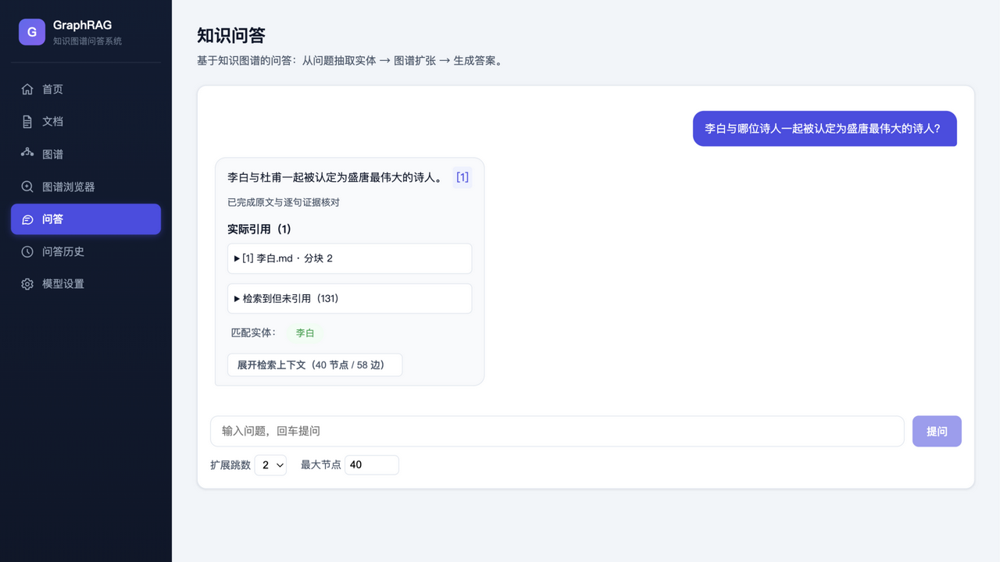
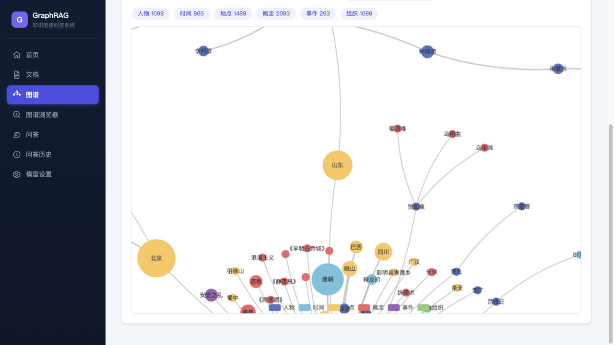

# 知识图谱 RAG 系统（GraphRAG）

面向**多领域中文百科语料**（人物/组织/地理/科技/事件）的知识图谱 RAG 系统：用 LLM 从文档抽取实体与关系构建图谱（NetworkX 持久化），查询时从问题种子实体 BFS 扩张检索，**不依赖向量库**；回答逐句附原文引用并通过证据校验，无法回答时诚实拒答。内置可复现的评测工具链（手工金标 + 合成回归集），FastAPI 后端 + Vue 3 前端（含图谱可视化）。

| 问答（逐句引用与证据校验） | 图谱可视化 |
|---|---|
|  |  |

## 架构

```
文档(PDF/MD/TXT/DOCX) → 加载 → 中文分块 → LLM 抽取实体/关系 → NetworkX 图谱 → JSON 持久化
查询: 问题 → LLM 抽种子实体 → 定位 → BFS 扩张 → 中文上下文 → LLM 生成答案
```

实体抽取与问答使用 OpenAI 兼容端点（自定义 base_url + api_key）。

## 目录结构

```
├── src/graphrag/          # 后端（config/schemas/loaders/splitting/llm/graph/retrieval/pipeline/api）
│   └── supervisor/        # 引导服务（后台管理启停与自动重载，端口 8001，无页面）
├── web/                   # Vue 3 + Vite + ECharts 前端
├── tests/review_checks.py # 离线回归检查（51 项，假模型 + 临时目录，不调真实模型）
├── scripts/               # restart.sh、smoke_extract.py（真实模型冒烟）
├── evals/                 # 评测工具链（语料拉取/金标/合成集/运行器）
├── data/                  # 运行时数据（文档/分块/图谱/日志，git 忽略）
├── 启动GraphRAG.command   # macOS 双击启动
├── start.sh               # 命令行启动/重启脚本
├── .env.example           # 环境变量模板
└── requirements.txt
```

## 端口

| 端口 | 服务 | 说明 |
|---|---|---|
| **8002** | RAG 系统 | 主应用（首页/文档/图谱/图谱浏览器/问答/问答历史/**模型设置**） |
| **8001** | 引导服务 | 纯后台（无页面），负责拉起 8002，并在后端源码变更时自动重载 |

日常使用只进 **8002**：「模型设置」页配置 LLM 并查看运行状态。8001 无需手动访问；业务页面不提供服务启动、停止或重启按钮。

## 快速开始

前置要求：Python 3.10+、Node.js 18+、一个 OpenAI 兼容的模型端点（base_url + api_key）。conda 非必需，但启动脚本默认按 conda 环境启动。

### 1. 后端环境（仅首次）

```bash
conda create -n langchain python=3.10 -y   # 环境名可自取，用 CONDA_ENV 环境变量指定
conda activate langchain                   # 或 export CONDA_ENV=你的环境名
pip install -r requirements.txt
cp .env.example .env                       # 填入你的 base_url / api_key / 模型名
```

### 2. 前端构建（仅首次）

后端只在 `web/dist` 存在时提供页面，clone 后必须先构建：

```bash
cd web && npm install && npm run build && cd ..
```

### 3. 启动

**方式 A（推荐，macOS，无需终端）**：双击项目根目录的 `启动GraphRAG.command` → 确保系统运行并打开 http://localhost:8002；已在运行则不会打断当前任务。窗口会显示后端 PID、启动时间和自动重载状态。

**方式 B（命令行）**：

```bash
./start.sh            # 启动问答系统（先清理端口上的旧后端）
./start.sh restart    # 重启后端（构建中会询问；--force 跳过）
./start.sh dev        # 开发模式：前端 :5173 + 后端 :8002（热更新）
```

> 手动启动后端备用命令：`PYTHONPATH=src python -m uvicorn graphrag.api.main:app --port 8002`

### 4. 代码变更与重启

- 改后端代码（`src/`，不含 `supervisor/`）：控制服务空闲时自动重载；构建进行中会延后到任务结束。页面无需刷新。
- 改前端代码：重新构建 `web/dist` 后刷新页面即可，无需重启后端。
- 改 `src/graphrag/supervisor/`：`./start.sh restart --supervisor`。
- 改非 LLM 的 `.env` 配置（分块、并发、发布间隔等）：`./start.sh restart`。
- 在「模型设置」页保存 base_url / api_key / model 不需要重启，下一次模型调用即生效。

### 5. 日常使用（都在 8002）

1. **模型设置**页：填写 **base_url / api_key / model** → 保存；新建的模型请求使用新配置
2. **文档**页上传 → **图谱**页构建 → **问答**页提问
3. 构建时可以切换页面；刷新后进入图谱页，会继续显示最近一次任务。后端代码变更会在构建结束后自动重载；手动重启（`./start.sh restart`）会终止正在运行的任务，页面会提示任务不存在，重新点击构建可从已保存的进度继续

## 使用流程

1. **文档**页签：上传 PDF / MD / TXT / DOCX（多文件）
2. **图谱**页签：点击「构建图谱」→ 轮询进度 → 查看统计与图谱可视化（点击节点高亮邻居）
3. **问答**页签：输入问题 → 展示答案、匹配实体、检索上下文与相关子图

## API 端点

| 方法 | 路径 | 说明 |
|---|---|---|
| POST | `/api/documents/ingest` | 上传文档 |
| GET | `/api/documents` | 文档列表 |
| POST | `/api/graph/build` | 异步启动建图，返回 job_id |
| GET | `/api/graph/build/status/{job_id}` | 构建进度 |
| GET | `/api/graph/stats` | 图谱统计 |
| GET | `/api/graph/viz?limit=300` | 已保存图谱快照（含版本和完整统计，限制画布大小） |
| POST | `/api/query` | 问答 `{question, hops, max_nodes}` |
| GET | `/api/graph/export?fmt=graphml` | 导出图谱 |

## 配置项（.env）

| 变量 | 说明 |
|---|---|
| `OPENAI_BASE_URL` | OpenAI 兼容端点地址（如 `https://xxx/v1`） |
| `OPENAI_API_KEY` | API Key |
| `OPENAI_MODEL` | 模型名 |
| `STRUCTURED_OUTPUT_METHOD` | `json_mode`（默认）/ `function_calling` / `json_schema` |
| `LLM_TIMEOUT` / `LLM_MAX_RETRIES` | 模型请求超时秒数（默认 120）/ SDK 层重试次数（默认 3） |
| `CHUNK_SIZE` / `CHUNK_OVERLAP` | 分块大小/重叠（字符） |
| `EXTRACTION_CONCURRENCY` | 抽取并发数 |
| `BUILD_CHECKPOINT_INTERVAL` | 阶段保存间隔，默认新增 5 个成功分块；首个成功结果立即保存；大语料下会按总量自适应放宽 |
| `BUILD_PUBLISH_INTERVAL` | 有新结果时的最长批次等待时间，默认 2 秒 |
| `BACKEND_AUTORELOAD` | 后端源码变更自动重载，默认 `1`（开启）；`0` 关闭 |
| `EXTRACTION_THINKING` | 可选 enabled / disabled，仅对支持 thinking 参数的模型设置；只作用于抽取调用，默认不发送该参数 |

## 评测

内置可复现的评测工具链（语料拉取 → 金标/合成集 → 运行器 → 报告），报告输出到 `data/evals/report_*.json`：

- `evals/fetch_corpus.py`：从中文维基镜像（hf-mirror）拉取 50 篇文档入库并建图，索引 `data/evals/corpus_index.json`（event/geo/general/org/person/tech 六类）。
- `evals/gold/wiki_gold.jsonl`：**手工金标 20 题**（六类覆盖 × 单跳事实/实体关系/时间/否定边界四题型），每题 gold_quotes 逐字摘自分块原文，`evals/gold/build_gold.py` 内置逐字校验，写入前强制通过。
- `evals/generate_qa.py`：从分块合成回归集 `data/evals/synthetic.jsonl`（57 题），quote 必须是分块逐字子串（防循环引用），自动跳过纯标题块。
- `evals/run_eval.py`：评测运行器，逐题调用 `service.answer` 并输出来源召回率 / 引用正确率 / 忠实度 / 逐字引用校验通过率 / 否定题诚实拒答率 / 种子定位率与延迟 p50/p95。

### 基准数字

图谱 6927 节点 / 8462 边（50 篇中文维基语料，模型 deepseek-v4-flash，2026-11-04）：

| 指标 | 金标 20 题 seed | 金标 20 题 full | 合成 50 题 full |
|---|---|---|---|
| 来源召回率 | 93.8% | 68.8% | 78.0% |
| 引用正确率 | 39.6% | 12.5% | 46.0% |
| 忠实度（verified 比例） | 40.0% | 15.0% | 54.0% |
| 逐字引用校验通过率 | 55.0% | 85.0% | 42.0% |
| 否定题诚实拒答率 | 100%（4/4） | 100%（4/4） | — |
| 种子定位率 | — | 75.0% | 80.0% |
| 延迟 p50 / p95 | 15.3s / 74.6s | 14.9s / 69.0s | 19.3s / 230.1s |

指标口径：来源召回率 = 金标分块被检索到的比例；引用正确率 = 被引分块属于金标的比例（拒答题计 0）；忠实度 = 回答通过句级证据审核的比例（证据不足拒答不计入通过）；种子定位率 = 问题实体在图中命中的比例（仅 full 模式）。

### 复现

```bash
PYTHONPATH=src python evals/generate_qa.py                                          # 合成集
PYTHONPATH=src python evals/run_eval.py evals/gold/wiki_gold.jsonl --mode seed      # 金标 seed
PYTHONPATH=src python evals/run_eval.py evals/gold/wiki_gold.jsonl --mode full      # 金标 full
PYTHONPATH=src python evals/run_eval.py data/evals/synthetic.jsonl --mode full --limit 50
```

### 评测暴露的两个主要瓶颈

1. **查询实体定位（full 模式）**：问题实体抽取出的裸名（如「改革开放」「气象学」）在图中存在同名/含名多节点时，`locate()` 按歧义约定返回 None（避免错误落点），约 1/4 题目种子落空导致空检索。对照：人工给种子（seed 模式）召回 93.8%。改进方向是别名表收录裸名消歧或在定位失败时回退到分块词检索。
2. **来源排序与上下文窗口**：2 跳图扩张召回可达 170 块，金标分块常排在 100+ 位，而答案生成只取前 40 块——证据「在库不在窗」，系统按设计诚实拒答（否定题拒答率 100%、全程零误答），但可用性受损。来源重排序 / 上下文压缩是下一优先级。

防幻觉链路得到验证：逐字引用校验 + 句级证据审核 + 否定边界诚实拒答在 70 题上无一硬编。

## 说明与限制

- 新回答按事实句附带分块引用，可展开证据片段和完整原文。实际引用与检索到但未引用的材料分开展示。
- 回答先核对引用编号和逐字原文，再调用一次模型审核每句结论是否由完整分块支持；未通过的句子移除，校验失败返回错误。语义审核仍依赖模型判断，并非事实正确性的证明。单次生成最多提供前 40 个来源分块，其他检索来源仍可查看。
- 问答历史保存当时的原文证据快照；删除文档后历史仍可核对，来源标记为“原文已删除”。
- 纯图谱检索：问题实体不在图中时无法回答，系统会诚实提示（可配合 `seed_override` 调试）。
- 中文 PDF 依赖内嵌文本，扫描件需 OCR（预留扩展点）。
- 若结构化输出大面积失败，切换 `STRUCTURED_OUTPUT_METHOD=function_calling`。

## 更多文档

- [docs/INTERNALS.md](docs/INTERNALS.md)：构建检查点与增量发布机制、长任务与进度实现细节、火山方舟 Coding Plan 配置、真实模型冒烟检查。
- [docs/](docs/)：开发历程与工程决策记录（审查报告、修复方案、实时图谱与实体抽取改造记录）。
