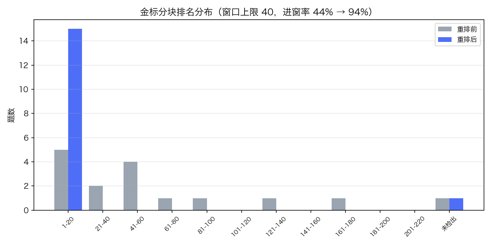
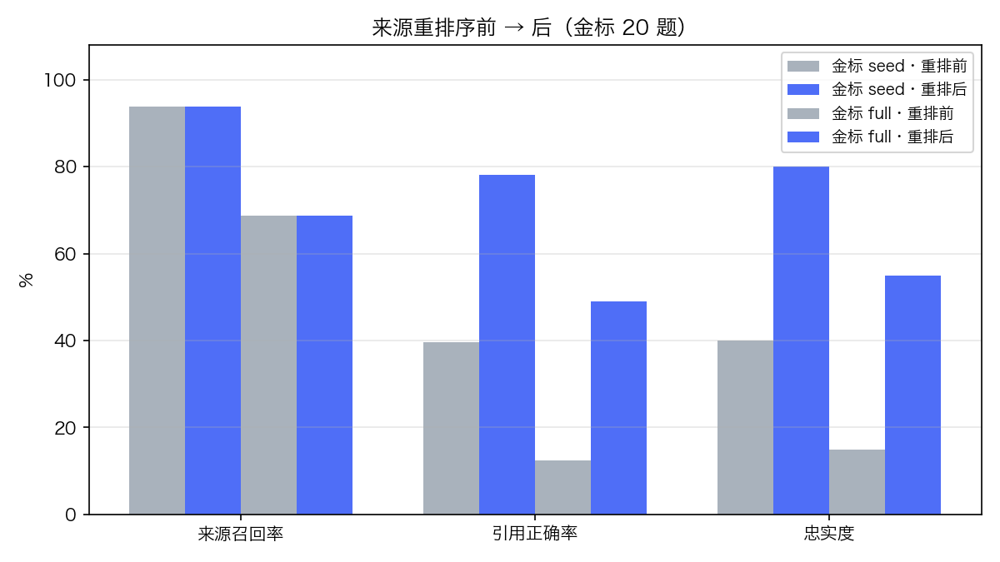
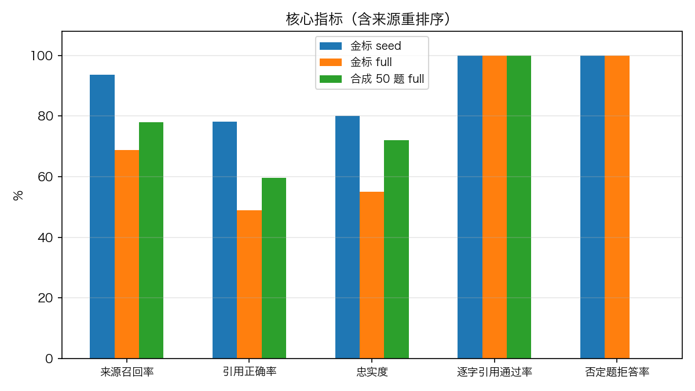

# 工程实录：问题、瓶颈与突破

本文记录项目迭代过程中的真实问题、用评测数据定位的瓶颈、修复方式与量化提升。所有数字来自 [`docs/benchmarks/`](benchmarks/) 中随仓库提交的评测报告与诊断数据，图表可用 `PYTHONPATH=src python scripts/make_charts.py` 从这些数据原样复现。

环境基线：50 篇中文维基语料（506 分块）· 图谱 6927 节点 / 8462 边 · 模型 deepseek-v4-flash（火山方舟，OpenAI 兼容协议）· 2026-11-04 同日基线与重跑。

## 一、遇到并修掉的坑

每个坑都留有回归测试或诊断脚本兜底，防止复发。

### 1. 一个敏感分块炸掉整轮建图

- **现象**：50 篇语料建图跑到 45/50 时构建线程静默死亡，任务状态报错 `Could not parse response content as the request was rejected by the content filter`。
- **根因**：openai SDK 的 `ContentFilterFinishReasonError` 继承自 `OpenAIError` 而**不是** `APIError`；实体抽取的 `except (APIError, OutputParserException)` 接不住它，单个被内容过滤拒绝的分块在两次重试后把异常抛进构建线程，整个批次终止。
- **修复**：捕获放宽为 `OpenAIError`（覆盖内容过滤、长度截断等 SDK 错误），沿用"重试一次→跳过该分块"的语义。修复后重跑，8 个敏感分块被优雅跳过，其余 498 块全部成功。
- **证据**：commit `c9fc5ad`；回归检查 `test_content_filter_rejection_does_not_kill_batch`。

### 2. 评测器自己没加载图谱（险些全 0 分）

- **现象**：首轮跑评测时所有题目种子全部未命中、0 分。
- **根因**：图谱加载挂在 FastAPI 的 lifespan 钩子里，`run_eval.py` 作为独立进程直接 import service 单例，`store` 是空图。
- **修复**：评测入口显式 `service.load()`。这个坑的价值在于它证明了评测流程对"检索为空"和"检索后拒答"两种失败都要有独立可观测性。

### 3. macOS 自带 bash 3.2 的多字节变量名怪病

- **现象**：`restart.sh` 最后一行报 `pid…: unbound variable`，但脚本用 `set -u` 且 `$pid` 明明已赋值。
- **根因**：bash 3.2 把紧随多字节字符的 `$var` 连同后面的全角字符一起解析成超长变量名（`$pid，` → 变量 `pid，…`）。
- **修复**：`${pid}` 花括号终止变量名。全网少见的 macOS 中文环境特有坑。

### 4. 合成出题的退化

- **现象**：合成评测集出现"这个文本片段由哪两个字组成？"这类废题。
- **根因**：每篇文档的 chunk 0 只含标题；且题型按文档内下标轮换，per-doc=2 时永远只命中前两种题型。
- **修复**：跳过 <30 字符的标题块；题型轮换改为全局计数。金标 20 题则全部人工编写，quote 逐字摘自分块原文并脚本强制校验（`evals/gold/build_gold.py`）。

### 5. 评测器的逐字校验查错了键（指标从未生效）

- **现象**：重排序上线后，「逐字引用校验通过率」从 55% "暴跌"到 20%，且所有 verified 题无一幸免——过于系统化，一眼假。
- **根因**：`quote_check` 用数字 `source_id` 去 `chunk_id`（字符串）做键的查找表里查，永远 miss。校验器从未真正校验过任何东西：基线的 55% 实际是**无引用答案的占比**（拒答题空引用空洞通过）。
- **修复**：按数字 id 查找（commit `4f49631`）。修复后指标恒为 100%——这符合设计：逐字引用本就在生成层被结构性保证（非逐字引用句在进入答案前即被剔除，evidence.py 引用校验），独立复跑校验是审计金丝雀而非差异化指标，故**前后对比表中不列该指标**。
- **教训**：重排序让回答变丰富、引用变多，反而暴露了沉睡的 bug——测试覆盖"有引用的答案"与"无引用的答案"必须分开断言。

## 二、评测定位的两个瓶颈

评测工具链（[README 评测节](../README.md#评测)）在 70 道题（金标 20 + 合成 50）上量化出两个结构性瓶颈：

### 瓶颈①：查询实体定位（已定位，未修）

full 模式下问题实体由 LLM 抽取为裸名（如「改革开放」「气象学」），图中存在同名/含名多节点时 `locate()` 按歧义约定返回 None（宁可不落点也不选错），约 1/4 题目种子落空 → 空检索 → 拒答。

**量化对照**：人工指定种子的 seed 模式召回率 93.8%，full 模式只有 68.8%，差距全部来自种子定位（种子定位率 75%/80%）。改进方向明确（别名表收录裸名消歧 / 定位失败回退分块词检索），但实施时发现与"同名多类型实体保持分离"的既有歧义契约冲突（会破坏 `test_alias_ambiguity_and_types_stay_separate_in_any_order` 的语义），已回滚，留作独立课题。

### 瓶颈②：证据在库不在窗（已修，见下节）

2 跳图扩张召回可达 170-230 块，但 `collect_sources` 按 chunk_id 字典序排列——与问题相关性完全无关；答案生成只喂前 40 块。

**实例**：「清华大学始建于哪一年？」召回 170 块，金标分块（含"始建于1911年"）排在第 **124** 位——证据明明检到了，却被排在窗口外，系统只能按设计诚实拒答（这保证了零误答，但可用性受损）。



上图是 16 道有金标分块的金标题的排名分布：重排前只有 43.75% 的金标块落在前 40 窗口内（平均排名 50.3，散布到 41-180 名）；重排后 93.75% 进窗（平均排名 1.9）。唯一未检出的一题（「改革开放」）是金标分块根本没进候选集——图扩张覆盖问题，排序无法解决，如实标注。

## 三、突破：来源重排序

**方案**（`src/graphrag/retrieval/rerank.py`，零新依赖、毫秒级纯 Python）：

- BM25（k1=1.5, b=0.75，IDF 在当次候选集内计算）：问题词元 = ASCII 完整单词 + **CJK 字符二元组**（不引入分词器的中文检索惯用法）
- 实体锚定：匹配到的图实体名作为子串出现在分块正文 → 加分
- 种子锚定：分块是种子节点的证据块（`source_chunks`）→ 加分
- **只重排、不重新编号**：引用 id 随分块走，逐字校验、句级证据审核、问答历史快照全部零改动；`SOURCE_RERANK=0` 可一键关闭做 A/B 对照

**方法论**：权重先用金标 20 题做排名诊断校准（`evals/diagnose_rank.py`，零 LLM 调用、秒级迭代）——首跑即达标（平均排名 50.3 → 1.9），未做进一步调参；合成 50 题未参与任何调参，作为 held-out 问题集复验。前后对比同模型、同日、同题库。

**归因边界（诚实拆分）**：重排序只解决"种子命中、金标块在候选集中但排在窗外"的题；full 模式种子定位失败的题（瓶颈①）与图扩张未覆盖的题，重排序无能为力——这两类在数据中单独归类，不混入提升数字。

### 重排序前后对比（金标 20 题）



三数据集总览（重排序后当次评测；逐字引用校验修复后恒为 100%，系生成层结构性保证，不列入对比）：



## 四、实质提升汇总

| 指标 | 金标 seed（前→后） | 金标 full（前→后） | 合成 50 题 full（前→后） |
|---|---|---|---|
| 来源召回率 | 93.8% → 93.8%（持平） | 68.8% → 68.8%（持平） | 78.0% → 78.0%（持平） |
| 引用正确率 | 39.6% → **78.1%**（+38.5pp） | 12.5% → **49.0%**（+36.5pp） | 46.0% → **59.6%**（+13.6pp） |
| 忠实度（verified） | 40.0% → **80.0%**（+40pp） | 15.0% → **55.0%**（+40pp） | 54.0% → **72.0%**（+18pp） |
| 否定题诚实拒答 | 100% → 100% | 100% → 100% | — |
| 种子定位率 | — | 75.0% → 75.0%（持平） | 80.0% → 80.0%（持平） |

**解读（与归因拆分对照验证）**：

- 召回率三组全部持平——因果自洽：重排序只改变候选进入上下文窗口的顺序，不改变检索到的候选集本身。
- 引用正确率与忠实度大幅提升——金标块进入窗口后，模型引用正确、句级审核通过的比例随之上升；提升幅度受限于种子命中与图扩张覆盖（瓶颈①），full 模式的天花板仍由那 25% 种子未命中题压住。
- 否定题拒答与种子定位率不受影响——防幻觉语义与瓶颈①互相独立。
- **重排自身开销：平均 31-40ms/题**（timings.rerank_ms 实测），相比秒级 LLM 调用可忽略；延迟由模型端点主导，跨批次波动大于重排成本，故不做跨批次延迟对比。


## 五、复现

```bash
# 离线回归（53 项，假模型 + 临时目录）
PYTHONPATH=src python tests/review_checks.py

# 金标分块排名诊断（零 LLM，秒级）
PYTHONPATH=src python evals/diagnose_rank.py

# 三轮评测（需配置 .env 模型端点）
PYTHONPATH=src python evals/run_eval.py evals/gold/wiki_gold.jsonl --mode seed
PYTHONPATH=src python evals/run_eval.py evals/gold/wiki_gold.jsonl --mode full
PYTHONPATH=src python evals/run_eval.py data/evals/synthetic.jsonl --mode full --limit 50

# 图表（从 docs/benchmarks/ 已提交数据复现）
PYTHONPATH=src python scripts/make_charts.py
```

## 六、未修事项与下一步

1. **瓶颈①种子定位**：别名表收录裸名消歧（需与实体分离契约兼容），或定位失败回退分块词检索。
2. **图扩张覆盖**：「改革开放」类金标块未进候选集的题，需要更宽的检索或多路召回。
3. **延迟**：p95 仍在 60s+（模型端点主导），句级审核的两次 LLM 调用是主要构成；可探索小模型分层审核。
4. **语义审核的边界**：verified ≠ 事实正确，只是"每个结论都能在引用原文中找到逐字依据"。
